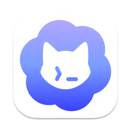
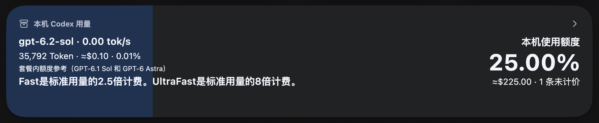

# TClash

**在同一个桌面应用里管理代理，查看 Codex 的速度、用量和预算进度。**

支持 macOS 与 Windows。单台设备可查看本机用量，配对后也可在「Codex 用量」汇总多台设备。

[下载安装](#安装) · [功能](#功能) · [用量怎么算](#用量怎么算) · [数据与隐私](#数据与隐私) · [版本记录](#版本记录)

仪表盘预览，使用演示数据。

## 安装

最新版为 **TClash 2.5.13**。下载与电脑匹配的安装包，双击完成安装。

| 平台 | 下载 |
| --- | --- |
| macOS · Apple 芯片 | [TClash 2.5.13 · PKG](https://github.com/IronMan-libingxue/TClash/releases/download/v2.5.13/TClash-2.5.13-macOS-AppleSilicon.pkg) |
| macOS · Intel | [TClash 2.5.13 · PKG](https://github.com/IronMan-libingxue/TClash/releases/download/v2.5.13/TClash-2.5.13-macOS-Intel.pkg) |
| Windows · x64 | [TClash 2.5.13 · EXE](https://github.com/IronMan-libingxue/TClash/releases/download/v2.5.13/TClash-2.5.13-Windows-x64-Setup.exe) |

**从旧版升级**　使用原系统账号安装并首次启动。新版会把原配对、令牌和用量历史迁移到独立用户目录。升级后可在 CodeX Speed 检查历史与配对状态。

**新设备配对**　在「Codex 用量」（A 端）生成该设备的首次配对安装包。单台设备可直接在 TClash 的 **CodeX Speed** 页面查看本机统计。

[2.5.13 发布说明与校验值](https://github.com/IronMan-libingxue/TClash/releases/tag/v2.5.13) · [历史版本](https://github.com/IronMan-libingxue/TClash/releases)

## 功能

- **配置与代理**　管理代理配置和策略组，切换出站模式，查看连接与流量。2.5.13 支持通过文件选择或拖放导入旧版 `.tclash` 包，识别有效内容并保留附带规则。订阅链接可继续下载和刷新。
- **本机用量仪表盘**　查看当前 Codex 模型、每秒输出的 Token 数和参考金额。蓝色进度表示所有模型合计的预算占比。
- **CodeX Speed 明细**　按周期查看本机的模型和项目用量，切换是否计入缓存 Token，查看活动会话以及已识别的 Fast、Ultrafast 状态。
- **多设备总览**　「Codex 用量」（A 端）汇总配对设备的用量，按设备、项目和请求查看明细，并统一设置预算、参考价表和设备显示倍率。

CodeX Speed 界面示例，使用演示数据。

## 用量怎么算

| 指标 | 计算方式 |
| --- | --- |
| 输出速度 | 根据最近可用的 Codex 调用估算每秒输出的 Token 数。首 Token 等待时间有效时，从总耗时中扣除 |
| Token 用量 | 从本机 Codex 会话记录读取输入、输出和缓存用量，按所选周期汇总 |
| 参考金额 | 按模型的输入、输出和缓存单价估算，并应用已确认的服务档位规则。缺少价格的记录显示「未计价」 |
| 预算占比 | 将参考金额除以设定的参考预算。A 端配置的设备倍率用于展示，原始用量保留供对照 |

A 端可选择 Magpie 使用的 Models.dev 价表或 Agent Speed 价表，并设置每日更新。TClash 使用内置价表时显示「本地价格表」，接收并验证 A 端价表后显示「价格表已更新」。[计价与预算说明](docs/设计与验收/04-A端用量计价与通知.md)

## 数据与隐私

采集器读取本机 Codex 已生成的会话记录，提取 Token 数、模型、项目分组和会话状态等统计字段。已配对的 TClash 将用量快照加密发送至配对所用的私有仓库，由 A 端汇总。[同步与价表验证说明](docs/设计与验收/05-B端FlClash迁移.md)

2.5.13 的用量资料保存在新版独立目录。macOS 使用 `~/Library/Application Support/TClash/collector`，Windows 使用 `%APPDATA%\TClash\collector`。[升级与迁移记录](docs/2.5.13-交付记录.md)

## 从源码构建

| 组件 | 源码与资料 |
| --- | --- |
| TClash 桌面端 | Flutter / Dart，基于 FlClash 和 Mihomo。[桌面源码](source/tclash) · [2.5.13 源码标签](https://github.com/IronMan-libingxue/TClash/tree/v2.5.13) |
| Codex 用量 | Go 用量采集器及 A 端应用。[用量采集源码](source/preview/codex-collector) |
| 打包 | macOS 使用 Xcode 和系统安装器，Windows x64 使用 Inno Setup。[技术栈、平台配置与原打包文件](docs/技术栈与构建.md) |

## 版本记录

- 2.5.13 的配置导入、独立目录迁移和平台验收。[2.5.13 交付记录](docs/2.5.13-交付记录.md)
- 逐次改版、对应提交以及已确认的产品决策。[版本索引](docs/版本索引.md) · [聊天确认与决议](docs/聊天确认与决议.md)
- 设计基线、验收标准和各阶段的源码范围。[设计与验收](docs/设计与验收) · [源码来源](docs/来源与回溯.md)
- 历史制品、完整性校验和离线恢复步骤。[历史制品索引](docs/历史制品索引.md) · [归档恢复](docs/历史归档恢复.md) · [归档验收](docs/归档验收.md)

## 上游与许可

桌面端基于 FlClash，早期 TClash Preview 基于 Clash Verge Rev，用量组件源自 Magpie。[桌面端许可证](source/tclash/LICENSE) · [早期 Preview 许可证](source/preview/LICENSE) · [用量组件许可证](source/preview/codex-collector/LICENSE)

本页的结构参考 Agent Speed。该项目也提供 A 端可选的参考价格来源。[Agent Speed 简体中文 README](https://github.com/IronMan-libingxue/agent-speed/blob/main/README.zh-CN.md)
