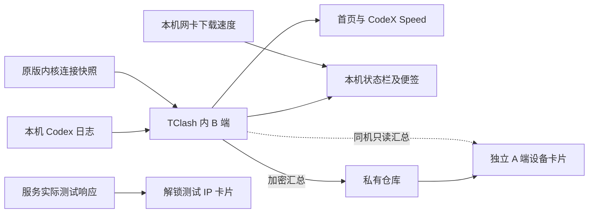

# TClash Preview 改造：四项原计划与 Fast／多会话监控补充

状态：**用户已确认方案，已开展改造并启动本机预览。** 以下基线和验收条目保留为改造前记录及验收目标，并不代表每项都已通过；本轮实际验证与待办见 [工作交接](../开发交接纪要.md)。

整理日期：2026-11-13（Asia/Shanghai）。本方案补充原有 `TClash-Preview-设计与验收方案.md`，不替代其中已经约定的 A/B 端边界、配置兼容目标与尚未完成的验收。

**后续设备扩容（2026-11-14）**：原方案中五台远端设备的范围扩展为 Mac 2～Mac 6、Windows 1～Windows 3；Mac 1 与各 B 均可自定义名称。其他设备按已确认的范围清理旧连接并从零测试，保留 Mac 1 数据。具体设计、私库历史边界和验收以 [设备扩容与重新分发方案](03-A端扩容与重新分发.md) 为准。

**后续用户补充（2026-11-13）**：普通独立会话运行时，A 对应卡片显示绿色二级高亮；没有运行会话时，本机模型速度显示 `0.00 tok/s`，无法确认会话状态时仍显示未知。TClash 的 CodeX Speed 页面删除截图指定的两处说明文字，代理流量的计算口径不变，A 端仍保留采集限制说明。用户已确认 Mac 状态栏双行和右键钉住交互验证完成；多会话将在本机由用户实测。

**倍率与账号归属纠正（2026-11-13）**：A 端所有用量、参考金额和参考预算占比均按原始记录计算，不能应用 B 的显示倍率；B 在本机按同一设备、同一周期、同一缓存口径的全量记录应用默认 1.5 倍（或 A 为该 B 设备设置的倍率），倍率不改写或上传原始数据。A 的设备卡片展示真实设备全量，并单独列出账号待确认的记录；已知属于其他账号的记录也明确标识。所选账号汇总与官方额度仍只归属于该账号，不把待确认记录算作已确认账号用量。设备全量相对参考预算的比例仅是折算，不是官方逐设备额度。

验收时以同一份包含已归属与待确认记录的样本核对：A 的原始 Token 和参考美元、待确认部分、B 的倍率后 Token 和参考美元及其预算占比一致；调整 B 倍率后 A 数值不变；切换设备明细、周期和缓存口径不丢失记录；未知价格提示不应使金额变成已知的完整消费。跨设备同步可能延迟，不同采集时间不作为倍率错误判据。

## 零、逐项需求对照

| 需求 | 本方案对应的指标与验收 |
| --- | --- |
| A 独立，B 集成 TClash | A 仍是唯一完整主控；TClash 启动带起 B；既定设备目标为 Mac 2、Mac 3、Mac 4、Windows 1、Windows 2，本机 A/B 不增加重复设备或重复 Codex 用量。见 2.1、4.3、4.5、5.6。 |
| B 设备自动接入 | A 为各目标设备生成预授权安装材料；B 安装后按已授权身份自动接入，B 页面不增加手动配对、同步或用量设置入口。已配对 Windows 1 的身份接续须安全验证。见 2.1、四点六、5.6 和原方案第四、六节。 |
| 跨网查看、频率与数据安全 | 沿用设备授权和私有仓库加密同步，默认 5 分钟并由 A 调整；A 下载和 B 上传有各自周期，离线可补传。见 2.1、4.3、4.5。 |
| 保留原有 Codex 统计 | A 继续查看各设备实际 Token、模型、项目、会话、请求及周期明细，并管理倍率与参考预算；B 端延续由 A 控制、默认 1.5 倍的本机展示，不能将估算视作官方逐设备额度。见 2.2、4.2、5.2、5.6。 |
| Codex 和原版配置兼容 | 不为采集修改 Codex 设置或接入 Magpie 网关；TClash 按已选的 Clash 原有规则工作，Codex 可能受系统代理/TUN 影响。原版订阅、YAML 和备份向 TClash 导入，以及专用导出不能由原版直接使用，继续按原方案回归；专用格式不是加密，未覆盖部分不称为已验证。见 2.1、5.6 和原方案第四、六节。 |
| 测试卡片出口 IP | 在原版每项检测和地区判断基础上补充可确认的对应 IP；单项/全部测试均更新，不能确认则显示未获取。见 4.1、5.1。 |
| 首页当前模型 | 首页订阅卡片显示本机模型速度、当前周期 Token、参考金额、比例及进度条，和 CodeX Speed 同口径。见 4.2、5.2。 |
| B 代理组当月流量 | 每组上传、下载、合计及设备总计，网络流量与 Codex 七天额度分开；同一连接经过多个代理组时，每组均记录，组总计相加包含重复流量。保留原版内核并标注可能漏计。见 4.3、5.3。 |
| A 设备卡片月流量 | 每个 B 的组别与月总量显示在 A 的对应设备卡片底部；同机 Mac 1 不新建虚假设备，未连接/离线显示数据时间和完整性。见 4.3、5.3。 |
| Mac 状态栏和 Windows 托盘 | Mac 两行分别是模型名与 tok/s、本机下载网速；Windows 使用托盘悬浮窗和可钉住便签。见 4.4、5.4。 |
| 状态栏悬浮和钉住 | 悬浮窗整体不透明度 40%，显示模型速度和最近使用的最多三个模型的用量，按最近时间排序；右键可钉住和取消。见 4.4、5.4。 |
| Fast 检测与统计 | B 的本机速度框出现闪电；按设备/会话/模型/周期统计可归属 Fast 用量并加密同步 A。本机 tok/s 不上传。见 4.5、5.5。 |
| A 端分级高亮 | 普通用量变化绿色二级，Fast 蓝色一级，多会话黄色一级，多会话加 Fast 红色特级；高优先级结束后保留原有未读提醒。见 4.5、5.5。 |
| 并发计数 | 只计正在执行任务的独立会话；等待工具算运行，打开但空闲不算，自动子代理不单独计数。见 3、4.5、5.5。 |
| 并发周期统计 | 按 Codex 重置周期记录可确认的并发发生次数、累计时长和独立会话数峰值；B 端简洁显示，A 端查看对应设备的统计，未覆盖时段标注不完整。见 3、4.5、5.5。 |
| B 端高并发提醒 | CodeX Speed 页面与首页订阅卡片均用柔和黄色高亮，显示“当前存在高并发风险，请仅保留一个任务运行。”；不自动停止任务。见 4.5、5.5。 |
| 颜色柔和 | A、B 的高亮低饱和、不持续闪烁，文字与图标清楚；多会话加 Fast 时 B 仍黄色、A 为红色。见 4.5、5.5。 |
| 可观测性边界 | 缺少证据时显示未知/未获取；模型速度是本机近期请求估算，订阅官方额度不是逐设备或逐模型的美元扣费。见 2.2、4.1、4.5。 |

## 一、需求范围

1. **解锁测试出口 IP**：保持 Clash Verge Rev 2.5.10 现有各服务的测试规则、请求和地区/解锁结果，在每张卡片上补充原有检测能可靠取得的对应出口 IP；单项和全部测试均更新相应卡片。取不到可靠值时如实标注，不用一个通用 IP 冒充全部服务的出口。
2. **首页模型信息**：在首页订阅卡片的空白区域，显示本机当前模型的名称、速度、当前周期 Token、参考美元、预算折算比例及进度条，口径与 CodeX Speed 一致。
3. **代理组月流量及 A/B 同步**：CodeX Speed 按自然月显示本机每个代理组的上传、下载及总量和设备汇总；B 端按现有授权和加密同步机制发送统计汇总，A 端在对应设备卡片底部展示。
4. **状态栏和悬浮便签**：macOS 顶部状态栏上行显示“模型名称：数值 tok/s”，下行显示本机下载速率；悬浮显示整体不透明度 40% 的便签，其中有模型速度及按最近使用时间排序、最多三个模型的用量；右键菜单可勾选“钉住便签”，取消勾选立即收起，之后仍可悬浮打开。Windows 采用托盘悬浮窗和可钉住便签。
5. **Fast 与多会话监控**：用户所称 Flash 已确认为 Codex 的 Fast 加速模式。B 端发现 Fast 活跃时，在 CodeX Speed 的本机模型速度条框显示闪电图标；发现本机多个独立会话同时运行时，在 CodeX Speed 页面及 TClash 首页订阅卡片以黄色高亮并显示用户指定提示。Fast 相关状态和可可靠归属的使用统计加密同步至独立 A 端。A 的设备卡片在 Fast 活跃、多个会话同时运行、两者同时发生时分别显示可区分的 Fast 一级、多会话一级和特级高亮。

## 二、改造前基线

### 2.1 产品与技术栈

- 基于 Clash Verge Rev **v2.5.10**，上游提交 `c83f7ad529c7c9cb3d2d54a0955ef8c1b22a411b`。当前工作区已有未提交改造，这个提交号不是当前 TClash 的完整快照；实施前须保护现有工作区和已安装程序，不重置或覆盖未归档工作。
- 主应用：Tauri 2.12.4 / Rust，React 19、TypeScript、Vite 和 MUI。当前稳定代理内核基线为 Mihomo v1.19.33；不同平台和所选内核需分别核对。macOS 托盘已有上游的两行网速绘制与右键菜单。
- 本机用量：TClash 内含的 B 端采集和同步采用 Go 1.26.8；Rust 主程序管理独立采集进程，页面经本机进程通信读取汇总。独立 A 端仍为 Go / Wails 3 的 `Codex 用量.app`，不融入 TClash。
- A/B：B 端使用现有设备身份、签名、加密及 GitHub 私有仓库同步。新设备默认同步间隔 5 分钟；A 可以调整，已有设置应原样保留。2026-11-13 的交接记录显示当时 A 已设为 1 分钟，实施时必须重新核实，不得擅自覆盖。双方各自定时同步，联网正常时 A 看见变化可能需等待 B 上传和 A 下载两个周期，离线和休眠还会延迟。
- 同机 A/B：现有 B 检测到同一系统用户已有 A 端时仅本地显示并暂停上传，避免重复计算同机 Codex 日志；因此现有机制不会自动把同机 B 的新增代理流量送到 A。
- 用户已反馈原独立 Windows B 和 Mac A 的配对展示验收成功；这不等于 Windows 版 TClash 或本次新功能已经实机验收。当前 Mac 预览、配置样本验证和遗留事项见 `TClash-Preview/HANDOFF.md`。

### 2.2 现有数据能做什么

- **模型用量**：已有项目/模型、周期、是否包含缓存和由 A 控制的 B 端显示倍率，Token 与参考美元默认按 1.5 倍展示；A 接收真实用量并保留现有参考预算折算。默认 900 美元是可调整的参考预算，不是官方确认的订阅总额度；参考美元和自定义预算占比不是官方扣费或官方逐设备额度。多台设备共用同一 ChatGPT 账号时，官方额度属于账号整体，不能按设备求和。倍率不作用于代理网络字节。
- **模型速度**：现有采集每约 4 秒检查本机记录，按选中/最近模型的可计算请求估算 tok/s；有可用的首字耗时则尽量估算生成阶段，否则是包含等待的整次请求平均。不能仅凭当前日志保证逐 Token 的即时流速；选中模型没有可计算记录时显示缺失。速度只在本机显示，不同步 A。
- **解锁测试**：现有卡片结果包含服务、状态、地区和时间，没有出口 IP。不同服务及同一服务的不同测试请求可能访问不同域名，也可能命中不同代理组或动态节点。
- **实时网速**：现有托盘两行速率来自 Mihomo 的代理流量，不天然等于整台电脑所有网卡的下载速度。
- **代理组流量**：现有界面可读取代理内核实时整体流量与活动连接，但尚无可靠、持久的“本机按代理组划分的自然月历史账本”。本月过去的数据能否补齐尚未证实，不能假定已有完整历史。
- **Fast 与会话状态**：只读抽样了本机近期 30 个 Codex 日志文件尾部片段（每个最多 2 MB），发现会话设置中存在 `service_tier`（如 `priority`、`default`），也存在任务开始、完成和中断事件；没有输出会话正文。这些是文件样本，不代表 30 个互不相同的会话。当前 TClash B 采集结果与 A 设备卡片尚未解析或同步这些状态。样本中的“设置”说明会话选择/请求的档位，不能单独证明每次请求实际由哪种档位执行，也尚不能据此保证会话存活判断和每条 Token 的准确归属。
- **Magpie 参考边界**：现有 Magpie 源码中有识别请求档位及记录返回档位的逻辑，部分信息来自经过 Magpie 网关的请求/响应。本方案不为此将 Codex 改接到 Magpie 网关：先研究读取 Codex 已有日志中的设置和事件，缺失的数据必须标记未知。[Magpie 网关档位记录](https://github.com/yetone/magpie/blob/10c4dc109a7b17e1dad5193d5d907b592552cfbf/internal/gateway/tier_record.go)、[OpenAI Fast 模式说明](https://learn.chatgpt.com/docs/agent-configuration/speed)
- **并发能力基线**：Magpie 的本机会话追踪已有增量读取、任务开始/完成/中断以及工具调用的处理，但当前 TClash B 未把这些事件汇总成用户要求的独立活跃会话数。其代码明确指出长时间等待并不代表任务结束；不能简单以“日志一分钟没更新”判定空闲。TClash 启动时若任务早已开始，现有追踪读者的启动边界也需要额外核对，不能默认它自动发现所有已有任务。
- **同步新鲜度基线**：现有 B 上传会忽略仅采集时间变化、实际用量未变的记录，因此不能直接把旧用量文件的时间当成持续在线或 Fast 状态心跳；要实现可信的设备状态提示，需设计受同步间隔约束的状态更新及过期处理。
- **刷新周期基线**：当前工作区代码的 B 端本机速度采样及页面刷新约 4 秒；A 的后台任务按分钟检查同步，B 的实际上传受 A 下发间隔控制。模型用量与新状态并不因为页面 4 秒刷新就必然重新采集。部署后的具体间隔、休眠和网络情况需实测。
- **仓库执行约束**：当前 TClash 代码的原版远端指向 Clash Verge Rev；其 [AGENTS.md](../../source/preview/AGENTS.md) 写明 “Product bug fixes and features require a pre-existing issue”。只读按 TClash、Codex 用量等关键词搜索上游未找到对应记录，这不等于检查了所有 Issue。用户已明确本次仅在本机改造，以确认后的设计方案作为任务依据；不向上游或其他仓库发帖。若以后拟向上游提交，再单独对齐其流程。

## 三、已选口径与待确认的方案

用户已经选择：

1. **多层代理组**：用户最新明确选择：同一连接经过 A、B 两个代理组时，A 和 B 各记录一次；所有代理组总计是各组相加，包含这笔重复流量。这更新并替代此前“每条连接只归一个组”的选择。
2. **出口 IP**：只显示能够确认的网站实际出口 IP；无法确认时显示“未获取”，不以额外探测值代替。
3. **Windows 状态栏**：Mac 顶部显示两行；Windows 通过托盘悬浮窗和可钉住便签显示同样信息。Tauri 的托盘文字标题在 Windows 上不受支持，不能将 Mac 原生做法直接算作 Windows 已可用。[Tauri 官方托盘接口](https://v2.tauri.app/reference/javascript/api/namespacetray/)
4. **Flash 名称**：用户确认这里指 Codex 的 Fast 加速模式。A 端判断 Fast 高亮时，同设备只要有一个活跃会话开启 Fast 就满足条件。
5. **设备卡片高亮**：普通用量变化为绿色二级高亮；Fast 活跃为蓝色一级高亮；多会话同时运行为黄色一级高亮；同一设备多会话同时运行且至少一个活跃会话使用 Fast 时为红色特级高亮。
6. **运行中会话**：用户确认只计正在处理任务的会话，等待工具执行的会话也算运行；已打开但空闲的不计。
7. **子代理**：用户确认多会话数量只计独立会话，自动子代理不单独计数。
8. **B 端多会话提醒**：同一 B 设备出现至少两个同时运行的独立会话时，CodeX Speed 界面和首页框选的订阅卡片均显示黄色高亮，并显示“当前存在高并发风险，请仅保留一个任务运行。”
9. **A/B 高亮视觉**：所有等级采用低饱和度或其他柔和处理，避免过于刺眼；保留已确认的绿色、蓝色、黄色、红色及各自含义。
10. **自然月时区**：所有设备统一使用北京时间（Asia/Shanghai）划分月度代理流量。
11. **代理组统计来源**：保留原版 Mihomo 内核，使用其现有连接快照统计；用户接受可能漏计，界面必须清楚标注，不能冒充完整统计。
12. **任务追踪**：用户明确本次仅在本机改造，待整份方案确认后作为任务依据；不自动在上游新建 Issue。
13. **下载速率范围**：显示整台设备的下载网速，包括没有经过 TClash 的流量。
14. **子代理的 Fast 归属**：自动子代理不增加并发会话数量；其可可靠归属的 Fast 用量归入所属主会话，不能确认归属时标记未知。
15. **高并发周期统计**：按 Codex 重置周期记录并发发生次数、累计并发时长和同时运行的独立会话数峰值。

上述口径已逐项对齐；接口、刷新和验收细节见下文，整份方案仍待用户最终确认后才实施。

## 四、技术路线

建议的数据流如下；图示为待确认的设计，并非现有功能已经实现：

### 4.1 按服务获取出口 IP

- 按用户补充，**沿用 Clash Verge Rev 2.5.10 原有服务测试逻辑、请求与地区判断**，扩展现有结果，增加 IP、请求目标、观察时间和状态；与每次单项测试或全部测试的结果一起更新与保存。重测失败不能沿用旧值冒充本次结果，可明确标“上次”或“未获取”。
- 从该服务实际解锁测试请求的可信响应中提取网站实际看到的客户端地址。不同域名、不同请求即使属于同一个服务也可能路由不同，不能把某一个域名的结果当成其他域名的真实出口。
- **严格按用户选择：只显示能确认的网站实际出口 IP；否则显示“未获取”。** 不以通用出口查询、同节点的额外探测结果或代理服务器地址代替。若一次测试存在能确认的多个实际出口，分别列出并标明对应目标；不能判断时不显示猜测值。
- 上游当前结果对象并不保存 IP；例如已有检测只取响应中的地区字段。某些响应可能包含可读取的 IP，另一些可能没有；实施前不能承诺所有卡片都可显示具体地址，也不能由国家名称反推出 IP。
- 不更改现有订阅、DNS、系统代理或用户分流规则。出口 IP 仅用于本机测试卡片，不纳入 A/B 用量上传。

### 4.2 首页模型卡片

- 复用已有 B 端采集结果，建立首页与 CodeX Speed 共用的显示数据：模型、速度、时间、周期、缓存开关、倍率、参考金额和预算占比。
- 扩展本机模型汇总，保留每个模型在所选统计范围内最后使用的时间；悬浮便签据此选出最近三个，而非按 Token 消耗大小排序。首页、页面和便签复用同一计算结果，避免三处各自统计而产生差异。
- 首页默认显示本周期；当用户在 CodeX Speed 改变周期或缓存口径时，两个页面应明确使用同一口径，不出现同一模型数字不一致。没有当前周期或匹配模型数据时显示缺失，不借用其他模型或旧周期结果。
- 进度条表示现有的自定义预算折算比例，并与同一数值一致；参考美元/比例不标为官方扣费或官方模型额度。速度标注其估算性质和时间。

### 4.3 代理组月流量与同步

#### 统计来源和准确度

- Mihomo 现有 `/connections` 返回的是定时活动连接快照；连接在两次快照之间创建并结束时，分组明细可能从快照消失。只靠提高轮询频率无法保证全量。[Mihomo v1.19.33 快照实现](https://raw.githubusercontent.com/MetaCubeX/mihomo/v1.19.33/hub/route/connections.go)；[连接离开时的处理](https://raw.githubusercontent.com/MetaCubeX/mihomo/v1.19.33/tunnel/statistic/tracker.go)。
- **按用户最新选择保留原版内核，不增加自定义 Mihomo 统计补丁。** TClash 的后台组件读取原有活动连接快照及其计数和代理链，按连接在连续快照中的字节增量维护本机账本，并把可观察的流量分别记入经过的每个代理组。
- 在两次快照之间完成的短连接可能整条漏掉；连接关闭后，最后一次快照到关闭之间的流量也可能漏掉。快照只能给出已观察到的分组用量，A、B 均须标明“快照统计，可能漏计”和数据时间；不能把它展示为完整或精确的流量。即使加快轮询也不保证全量。
- 各组会按用户要求重复计算同一条连接，因此不能拿代理内核的整体物理流量减去各组相加的数字来推算漏计量；缺失多少无法可靠得知时显示未知，不能编造“未归类差额”。
- 统计起始时间和覆盖状态必须可见：开始采集以前、程序或内核未运行期间，以及异常断电导致尚未持久化的数据，无法凭空补齐；正常退出/重启应恢复已落盘数据。连接跨北京时间月末时，快照间的流量只能按观测时间近似归月。服务模式下应核实真实流量路径，避免统计进程退出后核心仍运行却被误标为完整。

#### 归属、存储和显示

- 统计对象是**经过该设备 TClash 的代理组流量**。同一连接在可见代理链中经过多个用户配置的命名代理组时，各经过的组都计入同一笔观测到的字节；节点名称与代理组名称必须区分，不能把节点误作组。一条连接经过命名代理组再走 DIRECT 时仍计入该组；完全没有经过命名代理组的流量不并入代理组总计。
- 每组分别保存当月上传、下载和合计；设备代理组总计等于各组相加，**允许并按用户要求重复计入跨组连接**。例如 100 MB 依次经过 A、B，A 为 100 MB、B 为 100 MB，组总计为 200 MB。该组总计不是设备去重后的网络流量，也不等同服务商的计费用量。代理组重命名、订阅切换和同名组要有明确归属，不把不确定历史直接合并。
- 所有 B 端统一按北京时间（Asia/Shanghai）划分自然月；原始事件时间须保持可比较，旅行或设备本地时区变化不能改变同一统计月。每个内核实例的连接标识与上次快照增量需正确区分，以防重启和重复读取造成重复累计；这与用户要求对不同代理组分别计数并不冲突。
- 采集器首次看到已经存在的长连接时，若不能证明它的累计字节属于当前观测区间或月份，只建立基线并标记此前覆盖不完整，不把历史累计值当作新流量；之后按快照增量累计。能确认采集开始后新建的连接，才可按其首次可见累计量纳入统计。
- 采用本地持久化账本，优先复用现有 Go 侧 SQLite 能力；以设备、月份、统计口径、组别、计数、覆盖区间和更新时间为基本字段。仅存统计所需信息；不记录或上传访问的网站、目标地址、订阅内容、令牌、账户密码或原始连接日志。
- B 端只向 A 同步经过现有加密/签名保护的设备月度汇总及覆盖状态，仍按 A 端设定的频率运行；断网继续本地累计、恢复后补传。重复上传或接收同一份汇总不应重复累计。新字段需兼容旧版数据；旧版本无法显示新数据时不得损坏既有 Codex 数据。
- A 同机已有 TClash B 时，建议由 A 在本机只读、受系统用户权限保护的汇总文件中读取该机代理流量，显示到“Mac 1（本机）”，不恢复同机 B 的 Codex 上传，也不新增虚假设备。A 独立运行且没有 TClash 时，既有功能继续可用并显示流量未提供/最后数据时间。
- 远程设备卡片底部显示该设备当月各代理组和组内累计总计、数据时间及“快照统计，可能漏计”；与设备 Codex 七天周期并列而不混淆。代理流量独立于 Codex 账号和周期筛选，A 切换账号或七天周期不能改变同一设备的当月网络流量。流量按快照观测字节展示，不乘 Codex 的展示系数。

### 4.4 状态栏、模型速度和悬浮便签

- macOS 复用现有原生两行状态栏渲染能力：上行模型名和 tok/s，下行设备下载速率。网速按系统网络接口增量约每秒更新，适配 B/s、KB/s、MB/s；系统休眠、网卡切换或计数回退时重新建立基准，不能出现负数或离谱瞬时值。
- 首页、CodeX Speed 和状态栏读取同一份本机模型速度数据，空值和旧值标记一致。实现前先核查是否存在不改 Codex 配置、也不拦截其请求的更实时数据源；若没有，继续显示最近请求速度估算和时间，不把估算当成逐 Token 实时流速。
- 原生系统提示文本不能完整实现可交互、可钉住、40% 不透明度的便签；建议增加受限的无边框本机悬浮窗，按托盘图标位置定位。悬浮展示速度和当前统计口径内最近使用的模型，按最后使用时间从近到远，最多三个；不足三个全部显示。便签不上传模型速度。
- 保留原右键菜单及代理操作，新增带勾选状态的“钉住便签”。钉住后离开鼠标仍显示；取消立即关闭，下一次悬浮可重新打开。处理边缘屏幕、深浅色、缩放、外接显示器、隐藏窗口和退出生命周期。40% 指窗口整体不透明度；实际可读性和各系统窗口效果须以实机验证。
- macOS 首先按截图验收；Windows 按最终确认的托盘方案实机验证。不能把构建成功或 macOS 成功视为 Windows 已通过。

### 4.5 Fast 模式、多会话与设备卡片高亮

#### B 端识别和统计

- 在不修改 Codex 配置、不主动把 Codex 请求接到 Magpie 网关的条件下，扩展现有本机日志解析：按会话读取 Fast 档位标记、任务开始/完成/中断及可关联的用量；每个会话独立保存观察时间和状态，不能把一个会话的 Fast 状态赋给另一个会话。
- “高并发”在本设计中是对至少两个独立任务同时运行的监测结果，不是在 Codex 中新增或切换一个模型模式。B 页面仍保持简约，不新增手动同步按钮或 B 端设置入口。
- 按用户确认，只统计正在执行任务的独立会话；等待工具结果也算运行，仅打开但空闲不算。自动子代理不单独增加会话数量。主会话、用户主动启动的独立会话和自动子代理须根据可靠的来源信息区分；无法可靠判断时标记未知，不能简单以是否存在父线程来猜测。
- 复用 Magpie 的本机会话增量追踪能力，并以不读取正文的方式处理任务开始、完成、中断和工具等待。独立会话和任务 ID 用于去重与状态关联；文件轮转、部分写入、恢复会话及 TClash 启动前已开始的任务需单独处理。不能仅凭日志长时间无更新把正在等待工具的任务判为空闲；进程异常退出且缺少结束事件时应标记未知。
- 现有增量追踪有启动时间和最近会话文件数量等边界，需要适配启动前已运行任务与长时间等待任务；无法覆盖的会话或本机无法读取的远程/隔离日志应显示不完整/未知，不能把没有读到当作没有运行。Windows 原生与 WSL 的可见范围须分别核实。
- `priority`/`fast` 等值的含义按实际 Codex 版本及 OpenAI 文档核对，普通模型名称中包含 `flash` 不代表开启 Fast。Ultrafast 属于不同档位，不应未经确认自动混同。设置或请求的档位与服务器实际执行档位分开；缺少证据的实际档位显示未知。
- 若有任一可确认的活跃 Fast 会话，B 端的本机模型速度条框显示闪电，并注明是哪种状态；若当前速度对应的是另一个普通会话，不能让图标误导为该模型本次也在 Fast。无法确认会话是否仍活跃时显示“状态未知/上次观察时间”，不能把历史事件直接当作当前开启。
- 统计按设备、会话、模型和 Codex 周期保留可可靠归属的 Fast 请求数及输入、输出、缓存 Token；按用户确认，自动子代理的可确认 Fast 用量归入所属独立主会话，并标明来源，但不另加运行会话数量。这些 Token 同时属于现有模型总量，不能再加一次。缺失档位或无法唯一关联的用量列为“模式未知”，不能按 Fast 或普通模式猜测。历史完整性和实际执行档位以数据能证明的范围为准。
- Fast 的订阅额度影响、API 价格以及 B 端原有 1.5 倍展示不是同一个概念。A 的 Fast 明细优先展示真实可归属 Token 和请求数；如有可核实的价格规则才标“参考估算”，不能把模型美元估算说成官方实际扣费或逐会话官方额度。[OpenAI Fast 模式说明](https://learn.chatgpt.com/docs/agent-configuration/speed)

#### B 端多会话本机提醒

- 当本机可确认有至少两个独立会话同时运行时，CodeX Speed 页显示黄色高亮和提示“当前存在高并发风险，请仅保留一个任务运行。”；建议以该页的本机模型速度卡片及其提示区域呈现。TClash 首页按用户截图对订阅卡片整体作黄色高亮，并显示相同提示。
- 统计口径与 A 端一致：正在处理任务或等待工具结果的独立会话计入，打开但空闲的不计；自动子代理不单独计数。B 端使用本机检测结果，不因未配对 A、网络离线或 A/B 同机暂停上传而停止提醒。
- 无论是否有会话开启 Fast，满足多会话条件时 B 的两处提醒均为黄色；若同时存在 Fast，A 端对应设备仍按既有规则显示红色特级高亮。Fast 闪电标识保留，避免覆盖另一种状态。
- 当可确认运行中的独立会话恢复至一个或没有会话时，两处黄色高亮和提示自动解除。状态过期或无法可靠判断时标明未知，不把历史会话直接当作正在运行，也不声称风险已解除。提示仅供用户判断，不自动终止、暂停或修改任何 Codex 任务。
- B 端黄色高亮采用柔和色调、低强度背景或细边框等处理，避免大面积高亮色与持续闪烁；文字、图标和提示保持清楚可读，并适配浅色及深色界面。
- **高并发周期统计**：按用户确认，记录每个 Codex 重置周期内可确认的并发发生次数、累计并发时长和同时运行的独立会话数峰值，B 端简洁显示，A 端可查看对应设备的统计。次数、时长和峰值是实际可观察值，不乘 Token 和美元展示系数。独立会话数从少于两个转为至少两个算一次新发生；从两个升到三个只更新峰值，不重复增加次数。用可靠的开始/结束事件计算，缺失事件、观测中断或启动时已处于并发状态且无法确认开始时间的时段标记不完整，不推算为零，也不伪造历史。
- 若一次并发跨越 Codex 重置边界，已确认的持续时间按边界拆分计入两个周期；发生次数计入可确认的开始时间所在周期，新周期不重复增加一次，两个周期各自记录其可观察到的峰值。周期或账号归属无法确认时标记未知，不强行归属；上述统计通过现有授权与加密机制同步，A、B 对同一设备已确认的数据应一致。

#### 同步和 A 端高亮

- B 端将每个设备同一次观察得到的活跃会话数、Fast 活跃数、观察时间、状态可信度和必要的用量汇总，按原有设备身份、加密签名和 A 端同步周期上传；不同时间的旧快照不能拼凑成“同时发生”。不上传完整对话、原始日志或本机 tok/s。
- 将设备状态与已有用量变化分开处理：状态变化后按既定同步策略更新；会话持续活跃但 Token 暂未增加时，也要按受控同步周期更新可信观察时间，避免因现有“用量无变化则不上传”逻辑让 A 长时间使用过期状态。不能每四秒向私有仓库写入；状态无法继续可靠观测时应转未知。新状态格式须有版本及旧版兼容，重复接收不得重复增加 Token。
- 状态应尽量与该设备同周期的已加密用量/流量数据合并写入，避免为了界面刷新额外高频提交。按 5 分钟间隔计算，一台设备连续活跃 24 小时最多约有 288 次周期；五台同时持续活跃约有 1,440 次设备周期，实际仓库写入次数取决于合并与变化情况。GitHub 可能出现访问频率限制、提交历史增长或并发冲突，需有退避重试、最后成功时间和过期提示，不能通过缩短本机采样周期来绕过 A 端的同步设置。
- A 与 B 同机时，通过受系统用户权限保护的本机只读汇总读取状态和统计，复用 Mac 1 卡片，不恢复重复的 Codex 上传；其他设备走私有仓库。A 未运行或设备离线时显示最后观察时间，状态过期或未知时不声称当前仍在运行或已关闭。
- A 使用最新成功接收时间、B 的观察时间与现行同步间隔判断状态新鲜度；设备时钟异常、网络中断或缺少心跳时标记未知/过期，不能仅根据 A 上一次下载成功就断言设备当前仍在运行。
- A 的设备卡片“当前 Fast/并发”是设备当前观察状态，不应因切换 Codex 账号或历史重置周期而消失；卡片上须标注“当前/上次同步”时间，以免与所选历史周期的 Token 统计混淆。Fast 历史 Token 的账号归属仍须按原有可靠证据处理，不能将未知账号强行归到当前账号。
- 高亮由同一个新鲜且可信的设备快照决定，并在卡片上使用文字/图标辅助颜色辨识：

| 设备的可确认状态 | A 端卡片效果 |
| --- | --- |
| 只有普通用量变化 | 绿色二级高亮，保留未读提醒 |
| 有活跃 Fast 会话，但未能确认同时运行多个会话 | 蓝色 Fast 一级高亮；会话数量未知时另作标注 |
| 可确认同时运行多个会话，且未能确认活跃 Fast | 黄色多会话一级高亮；Fast 状态未知时另作标注 |
| 同时运行多个会话，且至少一个活跃会话为 Fast | 红色特级高亮，优先于两种一级及二级 |
| 会话或 Fast 状态缺失、过期、设备离线 | 标明未知或上次观察，不能把旧状态当作实时；仍可保留已确认的用量变化提醒 |

- 高亮颜色按用户标注执行：用量变化绿色、Fast 蓝色、多会话黄色、两者同时发生红色；配合文字和图标区分。Fast 或多会话状态结束后按当前可信状态回到相应等级，不清除原有未读用量提醒。
- A 端各等级颜色与 B 端提醒统一采用柔和的视觉强度，例如低饱和度色调、浅色背景与适度边框；避免刺眼的纯色大面积填充、持续闪烁或强发光。状态切换如有动效，使用短暂柔和过渡并遵循系统减少动态效果设置；文字和图标仍须清楚，不能仅靠颜色区分等级。
- 状态上传遵循已有同步间隔；正常联网仍可能经历 B 上传和 A 下载两个周期。这里的高亮是“最新已同步观察”，不是跨网秒级实时监控。

## 四点六、整体确认后的实施顺序

1. 在不覆盖现有工作区的前提下记录当前 A、TClash、采集器和原版内核的可回退基线；核对现有设备授权与同步设置，不打印或转存令牌、对话正文和真实配置内容。
2. 使用隔离的可控日志与连接快照样本，先接入 Fast/会话状态、按组月度流量及加密同步；验证未知状态、漏计标注、双层代理组重复计数和同机 A/B 去重。
3. 完成测试页、首页、CodeX Speed、独立 A 设备卡片与 macOS 状态栏/便签；保持低饱和颜色和用户指定提示语。同步处理 Windows 的托盘悬浮窗实现并分别构建。
4. 在本机使用真实本地 Codex 日志核对可见结果，同时以明确标识的模拟 B 验证跨设备展示；先不以样本或编译结果冒充跨网实机验收。保持现有 Codex 设置、原版 Clash、TClash 配置和设备身份。
5. 需要 Windows 真机或其他真实设备配合时向用户说明，再验证原有 Windows B 的身份接续、真实加密同步和托盘交互；未实测部分保留为待验收。

## 五、验收标准

### 5.1 解锁测试

- 用隔离的多路线测试服务，模拟服务 A、B 分别走不同出口；单项重测和全部重测后，每张卡片的 IP、来源和时间与其测试路径相符，不能全部复用一个公共出口。
- 覆盖真实响应、动态变化、多个出口、IPv4/IPv6、直连及无可验证来源；只显示可确认的网站实际出口，其他显示“未获取”。通用 IP 查询或额外路径探测结果不得当作网站实际出口。测试失败不保留一个看似本次成功的旧地址。
- 现有支持/不支持、地区、时间、单项及全部测试仍可用；不更改用户配置，相关 IP 不上传 A。
- 对照 2.5.10，验证各服务原有检测规则、请求目标及国家/地区判断没有变化；只从原有检测的可信响应补充可确认的详细 IP。响应没有 IP 时显示“未获取”，不能由国家反推地址。

### 5.2 首页模型信息

- 用有已知输入、缓存、输出和报价的本机样本，核对首页和 CodeX Speed 对同一模型、周期、缓存设置及倍率的 Token、金额、占比和进度条一致。
- 核对 B 端默认 1.5 倍的 Token 与参考金额、A 端保存的实际 Token，以及 A 端调整倍率后的显示；仅显示所选周期内实际有记录的模型。900 美元仅为可调整参考预算，官方账号额度不视作各设备独立额度。
- 切换模型、周期和缓存后两处同步；模型不存在、价格未知、无速度、无本周期数据时明确显示缺失或零的真实含义，不显示其他模型的旧速度。
- 深色/浅色、窄窗口及长模型名正常显示；不改变订阅卡片现有操作。

### 5.3 代理组流量和 A/B

- 使用可核对的本地 TCP、UDP、短连接及长连接样本，对照实际快照中的计数核对各组上下行；覆盖短于一次快照间隔的连接、组链嵌套、同名组、自动切换及 DIRECT/未归组情况。按用户最新选择，一条已观察的 100 MB 流量经 A→B 时 A 与 B 各计 100 MB；另一条已观察的 30 MB 流量直接进入 B 时计入 B；A、B 分别为 100 MB、130 MB，组总计 230 MB。
- 模拟完全发生在快照之间的短连接和连接关闭后的尾部流量，确认未观测到的数据不会被伪造；A、B 均显示“快照统计，可能漏计”，不能要求或宣称原版内核的快照已完整记录短连接。验证总计是各组观测值之和，不冒充设备去重流量或服务商账单。
- 验证采集器启动时已存在的连接、跨月长连接和重启后首次快照：无法确认所属时间段的历史累计值不能误计到当前月；跨月快照间的增量按观察口径近似归月并提示精度边界。
- 验证跨月、跨日、时区边界、程序正常退出重启、内核重启、离线、休眠、重复消息及设备编号不变；断电或其他未覆盖时段如不能补齐，显示不完整和最后可靠时间。
- 在本机模拟仓库验证两台 B 的加密汇总和 A 对应设备卡片；独立 A 与 TClash 同机时只增加本机流量信息，不产生第二台 Mac 1 或重复 Codex 用量。新老 A/B 版本混用时旧 Codex 数据不丢失。
- B 的快照观测分组数据与 A 对应设备数据一致，不受 Codex 1.5 倍显示系数影响；它可能漏计，不冒称实际全量。联网同步延迟以 B 上传与 A 下载的实际周期和时间戳核对，不承诺严格实时。

### 5.4 状态栏与便签

- macOS 顶栏显示正确模型及 tok/s、全机下载速度和单位；模型速度和首页、CodeX Speed 一致，网络接口断开、切换或休眠恢复无负数、伪零值或持续旧值。
- 在 0、1、2、3、超过 3 个近期模型的样本下，便签分别正确显示，按最近使用时间排序，且金额/Token 口径与 CodeX Speed 一致。验证 40% 整窗不透明度与文字可读性。
- 鼠标移入显示、移出收起；右键勾选后移出仍保留，取消后立即收起，再悬浮可重开。原来的菜单、代理模式、退出操作继续工作。
- 分别验证 Mac 和 Windows 上用户最终确认的交互；多显示器、不同缩放、任务栏隐藏及屏幕边缘不应让便签无法使用。Windows 实机未测试前不得标记通过。

### 5.5 Fast、多会话及分级高亮

- 用可控会话样本验证：单会话普通用量更新为绿色二级；单会话 Fast 为蓝色 Fast 一级；两个同时运行的普通会话为黄色多会话一级；两个同时运行且至少一个 Fast 为红色特级。等待工具的独立会话计入，已打开但空闲的不计；一个独立会话带多个自动子代理不应被误判为多会话。Fast 结束但仍有多个独立会话时退回黄色多会话一级，保留此前未读用量提醒。
- 覆盖多设备、同设备多个模型/会话、Fast 与普通混合、会话启动/结束/中断、子代理、应用异常退出、长时间空闲和离线重连。来源不完整或数据过期时显示未知/最后观察时间，不使用历史快照制造当前高亮；不同时间的两个会话记录不能拼成并发。
- 对照真实或隔离样本的会话设置、事件和 Token，验证 Fast 统计与模型总量不重复；缺档位、单轮覆盖档位或无法关联的记录必须显示未知。不得将设置档位误称为官方确认的执行档位或实际扣费。
- 在相应状态事件已写入并可读取的前提下，验证 B 本机闪电标识约四秒更新、现有周期加密同步和 A 端对应设备高亮；这不等于保证 Codex 开关每次都会立刻写入可读取事件。同机 A/B 不产生第二个设备，其他设备正常同步。本机速度数值不上传。Mac 和 Windows 必须分别验证；未实测的平台标为待验收。
- 本机事件已经落盘、状态来源可用且设备正常运行时，以可控样本连续核验至少五次，目标为事件落盘后 10 秒内在 B 两处显示或解除相应状态；无法满足应报告实测时间或缺失原因，不把页面刷新频率当作数据已更新。长时间等待工具不得因为超过一分钟无日志而误判空闲。
- 在可控时钟与模拟私库下验证状态变化、任务持续但 Token 不变、状态结束及 A/B 错峰同步：B 在自身同步周期内写入可验证的最新状态，A 在自身下一读取周期取到并显示；模拟离线、限流、时钟偏差和重连时必须标明上次观察或未知，不能拼接不同时刻制造特级高亮。真实 GitHub 的网络延迟、冲突和服务限流单独记录。
- A 切换账号或查看历史 Codex 周期时，同一设备的当前 Fast/并发高亮与上次同步时间仍正确显示；历史用量则继续受所选账号与周期约束，不能把账号不明记录强行归入当前账号。
- 在 B 端分别验证零个、一个、两个及以上运行中的独立会话：只有至少两个同时运行时，CodeX Speed 页面与首页订阅卡片均显示黄色高亮，并准确显示“当前存在高并发风险，请仅保留一个任务运行。”；等待工具计入，空闲会话和自动子代理不单独计入。恢复到一个或零个时自动解除；未知状态不误报为已解除。
- 验证多个会话且使用 Fast 时，B 两处仍为黄色并保留闪电，A 对应设备为红色特级；B 未连接 A、离线及与 A 同机时，本机黄色提醒仍可用。提示不能自动中止、暂停或修改会话。
- 在 A 端各色各等级、B 端两处黄色提醒及浅色/深色主题下，实际检查高亮柔和、不持续闪烁、文字易读；颜色与文字/图标足以辨认等级。多会话与 Fast 并存时依然为 B 黄色、A 红色，不因柔化而改变状态含义。
- 验证并发周期统计：独立会话数从 1 到 2 持续 10 分钟，其间短暂达到 3，然后回到 1，应记为一次并发、累计 10 分钟、峰值 3；重复读取同一事件不能重复累计。并发跨 Codex 重置周期时，时长按边界拆分，次数仅计入可确认的开始所在周期，两周期各自记录可观察峰值；日志中断、开始时间或归属不明时标记不完整，A、B 对同一设备的已确认统计一致。

### 5.6 共同回归与交付边界

- A 端继续独立运行；现有真实本机统计、设备身份、已连接 Windows 记录、官方额度、本机速度和 Codex 设置保持正确。
- 回归 TClash 订阅/YAML/备份、代理组与协议、系统代理、TUN、托盘、后台采集、A/B 加密同步和原版共存。不得把尚未覆盖的复杂配置、原版 GUI 逆向兼容或 Windows 真实联网标成已验收。
- 分别核对五个目标 B 设备的预授权材料与自动接入；已配对 Windows 1 接续原设备身份且不重复计算，失败时保留可恢复的原连接。B 不增加手动配对、手动同步或用量设置入口；独立 Windows B 的既有验收不代替 TClash 真机验收。
- 先在隔离环境用不含真实凭据的可控样本验证，再在本机展示；涉及用户真实代理和 Windows 设备的验证，分别记录范围与结果。性能验收需对比改造前后启动、长时间运行、CPU/内存及代理吞吐，确保新增统计不改变选路且无明显退化。
- 本次文档只整理方案。**收到用户明确确认后**才开始修改代码、打包或对真实设备进行功能测试。

## 六、主要依据

- 本地代码：`TClash-Preview/src/pages/unlock.tsx`、`src-tauri/src/cmd/media_unlock_checker/mod.rs`、`crates/clash-verge-media-unlock/`、`src/pages/codex-speed.tsx`、`src-tauri/src/core/tray/`、`src-tauri/src/utils/tray_speed.rs`、`codex-collector/internal/usagetracker/`。
- 已有方案和证据：`TClash-Preview-设计与验收方案.md`、`TClash-Preview/HANDOFF.md`。
- 上游源码：[Mihomo 连接快照](https://raw.githubusercontent.com/MetaCubeX/mihomo/v1.19.33/hub/route/connections.go)、[计数及连接生命周期](https://raw.githubusercontent.com/MetaCubeX/mihomo/v1.19.33/tunnel/statistic/tracker.go)、[Tauri 托盘事件和平台差异](https://v2.tauri.app/reference/javascript/api/namespacetray/)。
- Fast 参考：[OpenAI Speed 文档](https://learn.chatgpt.com/docs/agent-configuration/speed)、[Magpie 档位记录实现](https://github.com/yetone/magpie/blob/10c4dc109a7b17e1dad5193d5d907b592552cfbf/internal/gateway/tier_record.go)。
